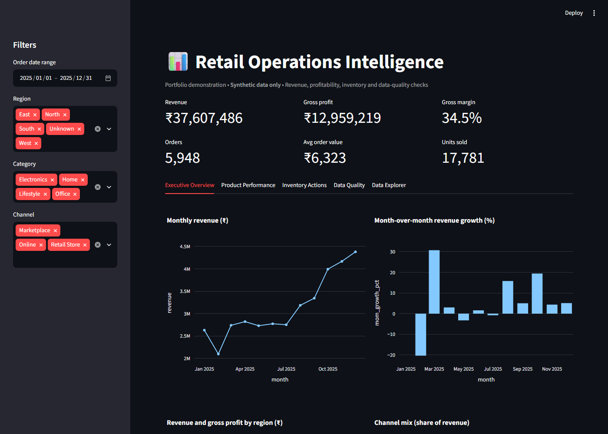
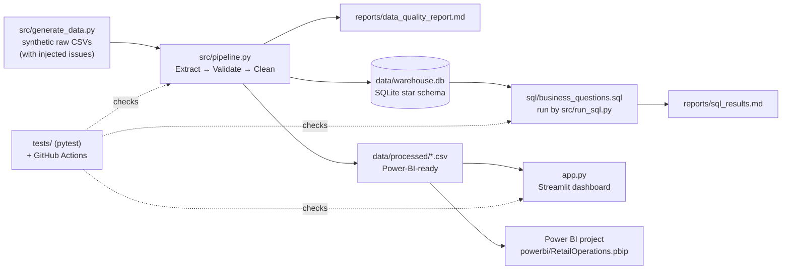
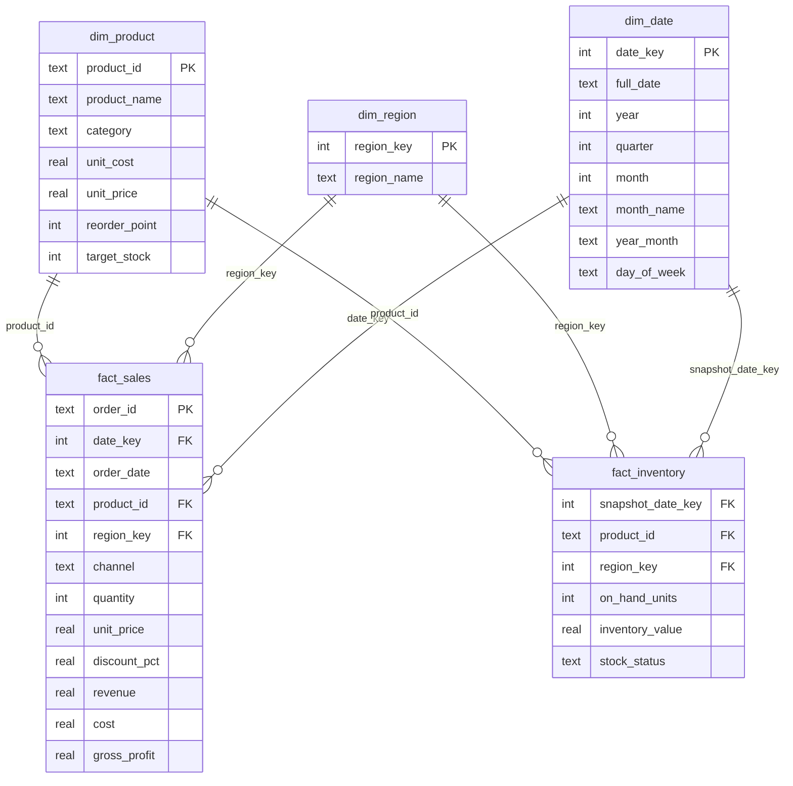
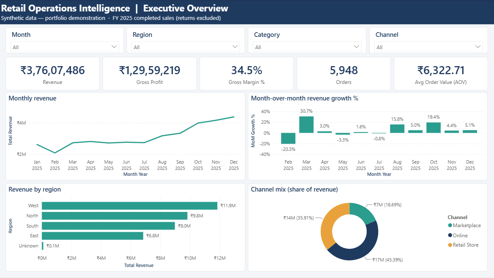

# Retail Operations Intelligence

An end-to-end, beginner-friendly analytics project: **raw CSV → data-quality validation & cleaning → SQLite star schema → SQL analysis → Streamlit dashboard → Power BI**.


**Live demo:** <https://retail-operations-intelligence-abhishek.streamlit.app> (Streamlit Community Cloud; the first load after a quiet period takes about a minute while the app wakes up).

> **Data honesty note:** every number in this repository comes from **synthetic (fake) data** created by `src/generate_data.py` with a fixed random seed (42). There is no real company, client, revenue or cost saving behind it. The data-quality problems in the raw file were **injected on purpose** so the cleaning step has something real to do.



---

## 1. Business problem

A (fictional) Indian retailer sells 20 products in 4 categories across 4 regions and 3 sales channels. Managers want to answer, from one trusted source:

1. How is revenue trending month by month, and how fast is it growing?
2. Which products, categories, regions and channels make the most money and margin?
3. Which products need to be **reordered** now, and where is cash tied up in **overstock**?
4. Can we **trust** the numbers? (duplicates, missing values, returns, wrong dates)

## 2. Architecture



## 3. Data model (star schema)



Full DDL: [`sql/schema.sql`](sql/schema.sql). Grain: `fact_sales` = one completed order line (one product per order in this dataset); `fact_inventory` = one product in one region on 2025-12-31.

## 4. Project structure

```
retail-operations-intelligence/
├── app.py                        Streamlit dashboard
├── src/
│   ├── generate_data.py          synthetic data + injected quality issues (seed 42)
│   ├── pipeline.py               Extract → Validate → Clean → Load + quality report
│   ├── metrics.py                all KPI formulas (used by app, pipeline and tests)
│   └── run_sql.py                runs every business query, writes reports/sql_results.md
├── sql/
│   ├── schema.sql                star schema DDL
│   └── business_questions.sql    10 commented business queries
├── data/
│   ├── raw/                      generated raw CSVs (dirty on purpose)
│   ├── processed/                clean star-schema CSVs for Power BI / Streamlit
│   └── warehouse.db              SQLite warehouse (~0.6 MB)
├── powerbi/                      Power BI Project (.pbip): TMDL model + PBIR report, build/validation scripts
├── reports/                      data_quality_report.md, sql_results.md
├── tests/                        pytest suite (26 tests)
├── docs/                         POWER_BI_GUIDE.md, INTERVIEW_GUIDE.md
└── .github/workflows/tests.yml   CI: rebuild data + run pytest on every push
```

## 5. How to run

Requires Python 3.11+ (tested on **Python 3.13.5**, Windows 11).

```bash
python -m venv .venv
# Windows: .venv\Scripts\activate      macOS/Linux: source .venv/bin/activate
pip install -r requirements.txt

python src/generate_data.py   # 1. create raw CSVs in data/raw/
python src/pipeline.py        # 2. validate, clean, load warehouse.db + processed CSVs + quality report
python src/run_sql.py         # 3. run the 10 business queries -> reports/sql_results.md
pytest -v                     # 4. run the tests (26 pass)
streamlit run app.py          # 5. open the dashboard at http://localhost:8501
```

The processed data and `warehouse.db` are committed, so `streamlit run app.py` works straight after cloning. If they are missing, the app runs the generator and pipeline once by itself.

## 6. Data-quality checks (actual output, synthetic data)

| Check | Rows found | How it was handled |
|---|---:|---|
| Exact duplicate rows | 60 | Removed (kept first copy) |
| Missing region | 15 | Kept the sale, region set to `Unknown` |
| Messy region text (`" west"`, `"NORTH "`) | 60 | Trimmed + fixed capitalisation |
| Messy channel text (`"ONLINE"`, `" retail store"`) | 60 | Trimmed + fixed capitalisation |
| Negative quantity (returns) | 40 | Excluded from `fact_sales`, saved to `returns_excluded.csv` |
| Date outside 2025 | 12 | Removed |
| Zero qty / unknown product / bad discount / conflicting order ids | 0 | Checked, nothing found |

Row flow: **6,060 raw rows → 6,000 after de-duplication → 5,988 after date filter → 5,948 clean sales** (+ 40 returns kept aside, 87 units). Full report: [`reports/data_quality_report.md`](reports/data_quality_report.md).

**Returns decision:** returns are not linked to their original order, so subtracting them could hit the wrong product/month. They are excluded from revenue KPIs and kept in a separate file for return analysis. Revenue in this project therefore means *completed-sale revenue*.

**Bug fixed from the first version:** inventory `on_hand` was drawn from `0..target_stock`, so "Overstock" (`on_hand > target_stock`) was impossible. It is now drawn from `0..1.5 × target_stock`, and all three statuses occur (Reorder 15, Healthy 37, Overstock 28 product-region rows). A test guards this.

## 7. KPI definitions

All formulas live in [`src/metrics.py`](src/metrics.py) and are unit-tested.

| KPI | Formula |
|---|---|
| Revenue (line) | `quantity × unit_price × (1 − discount_pct)` |
| Cost (line) | `quantity × unit_cost` (from the product catalog) |
| Gross profit | `revenue − cost` |
| Gross margin % | `gross profit ÷ revenue × 100` |
| Orders | count of distinct `order_id` |
| Average order value (AOV) | `revenue ÷ orders` |
| MoM growth % | `(this month − last month) ÷ last month × 100` |
| Stock status | `Reorder` if on hand ≤ reorder point; `Overstock` if on hand > target stock; else `Healthy` |
| Units to reorder | `target_stock − on_hand_units` |

## 8. Sample results (synthetic data — from `python src/run_sql.py`)

Headline KPIs (full year 2025): revenue **₹37,607,486**, gross profit **₹12,959,219**, gross margin **34.5%**, **5,948** orders, AOV **₹6,322.71**, **17,781** units.

**Gross margin by category (Q3)**

| category | revenue | gross_profit | gross_margin_pct |
|---|---:|---:|---:|
| Home | 8,868,535.60 | 3,399,797.60 | 38.3 |
| Electronics | 9,006,702.65 | 3,100,673.65 | 34.4 |
| Office | 9,844,861.90 | 3,274,328.90 | 33.3 |
| Lifestyle | 9,887,385.90 | 3,184,418.90 | 32.2 |

**Channel mix (Q4)**

| channel | orders | revenue | revenue_share_pct |
|---|---:|---:|---:|
| Online | 2,731 | 17,071,722.25 | 45.4 |
| Retail Store | 2,100 | 13,506,075.20 | 35.9 |
| Marketplace | 1,117 | 7,029,688.60 | 18.7 |

**Monthly revenue and MoM growth (Q1, first and last months)**

| year_month | revenue | mom_growth_pct |
|---|---:|---:|
| 2025-01 | 2,630,075.25 | – |
| 2025-02 | 2,095,186.25 | −20.3 |
| … | … | … |
| 2025-10 | 3,993,500.60 | 19.4 |
| 2025-11 | 4,168,230.05 | 4.4 |
| 2025-12 | 4,380,829.10 | 5.1 |

The Oct–Dec rise is **built into the generator** (festive-season weights), so it demonstrates the analysis, not a real market finding. All 10 query outputs: [`reports/sql_results.md`](reports/sql_results.md).

## 9. Tests

`pytest -v` → **26 passed** (validation finds each injected issue with the exact count; cleaned data has no duplicates, negative revenue or out-of-range dates; revenue formula; KPI functions; all 10 SQL queries run and agree with pandas; Streamlit `AppTest` runs the app with no exception). GitHub Actions rebuilds the data from scratch and runs the same tests on every push.

## 10. Power BI

A ready-to-open **Power BI Project (PBIP)** is in [`powerbi/`](powerbi/). It has a TMDL semantic model and a 4-page PBIR report: Executive Overview, Product Profitability, Inventory Alerts and Data Quality.



- **Model:** star schema with DimDate (marked as the date table), DimProduct, DimRegion, FactSales, FactInventory and Returns. Relationships are single-direction many-to-one, key columns are hidden, and 25 documented DAX measures live in `_Measures` (time intelligence uses `DATEADD`/`TOTALYTD`; share measures use `REMOVEFILTERS`). The CSVs load through Power Query with explicit column types and a `DataFolder` parameter.
- **Validated in Power BI Desktop 2.158 (Sept 2026):** the project opens without errors and a full refresh loads every table (FactSales 5,948 rows). Its measures were run as DAX queries against the open model and compared with SQL on `warehouse.db`: **126 of 126 checks match**, for example revenue ₹37,607,486.05, gross profit ₹12,959,219.05, margin 34.46%, Online share 45.39% and Home margin 38.34%. Details are in [`powerbi/VALIDATION.md`](powerbi/VALIDATION.md). Other pages: [products](assets/powerbi_products.png), [inventory](assets/powerbi_inventory.png), [data quality](assets/powerbi_data_quality.png).
- **To use it:** open `powerbi/RetailOperations.pbip`, set the `DataFolder` parameter to your clone's `data\processed` path (Transform data → Edit parameters), then click **Refresh**. No `.pbix` is committed; **File → Save as → .pbix** creates one. Full steps, plus a build-it-yourself walkthrough, are in [`docs/POWER_BI_GUIDE.md`](docs/POWER_BI_GUIDE.md).

## 11. Deploy (Streamlit Community Cloud)

1. Push this repository to GitHub (public).
2. Go to <https://share.streamlit.io>, sign in with GitHub, click **Create app**.
3. Repository: `Redskull2525/retail-operations-intelligence`, branch: `main`, main file path: **`app.py`**.
4. (Advanced settings) choose Python 3.13 if offered, then **Deploy**. Dependencies install from `requirements.txt`.
5. Paste the URL you get into this README only after it is working.

This repository is deployed at <https://retail-operations-intelligence-abhishek.streamlit.app> (deployed 19 Oct 2026 from `main`, `app.py`, Python 3.13; every tab was opened and checked after deployment).

## 12. Limitations

- Data is synthetic; patterns (seasonality, region/channel weights, margins) were chosen by the generator, so findings are not real insights.
- One product per order, so AOV equals average line value; real baskets have several lines.
- Returns are excluded rather than matched to original orders.
- Gross profit ignores shipping, tax, discounts funded by suppliers and operating expenses; it is not net profit.
- Inventory is a single snapshot (2025-12-31) with simple fixed reorder rules — no demand forecasting or lead times.
- SQLite is perfect for a local project; a production team would use a server database (PostgreSQL, SQL Server, cloud warehouse) and a scheduler.

## 13. Further reading in this repo

- [`docs/INTERVIEW_GUIDE.md`](docs/INTERVIEW_GUIDE.md) — how to explain every part of this project in an interview, with practice questions and exercises.

---
Built by Abhishek Shelke as a learning/portfolio project. Synthetic data only.
